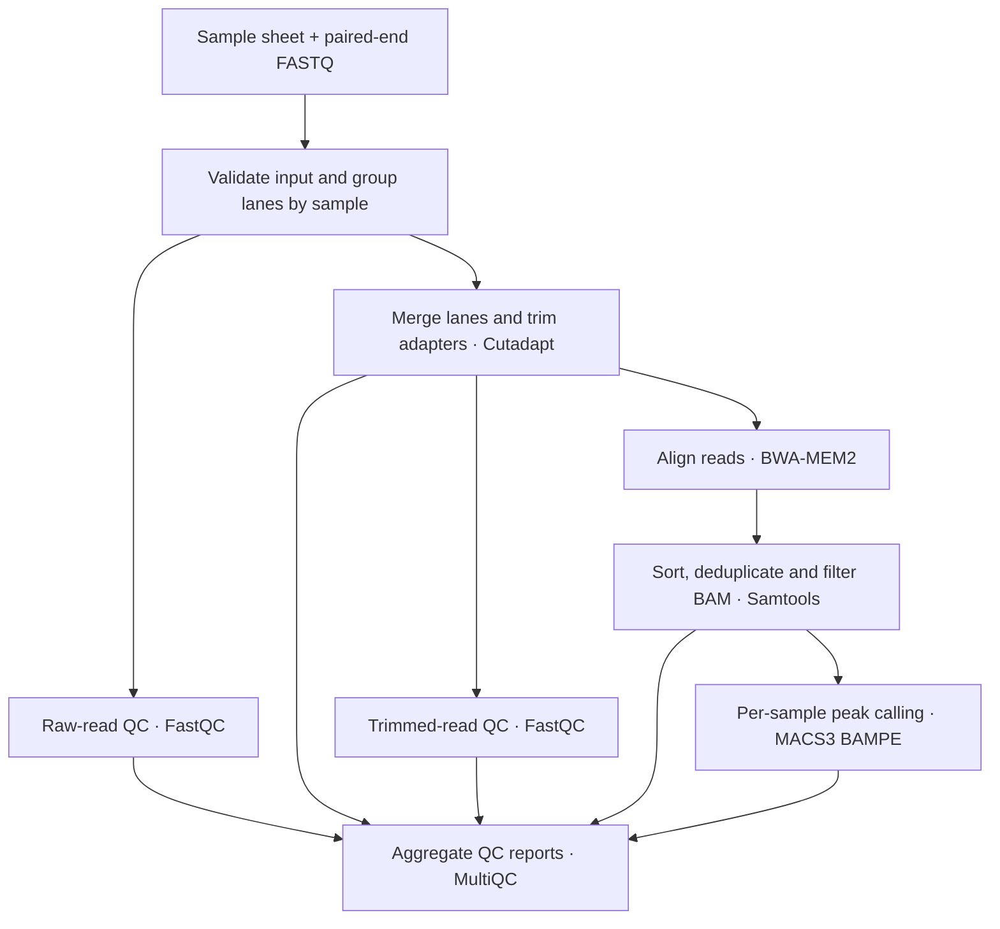

# dmagna-atac

`dmagna-atac` is a Nextflow pipeline for processing paired-end ATAC-seq data from *Daphnia magna*. It takes raw FASTQ files and an explicit sample sheet as input and produces filtered alignment files, per-sample accessible-chromatin peak calls, and quality-control reports.

Developed as a KU Leuven research-course project, the pipeline runs on Nextflow and Apptainer. It takes inspiration from [nf-core/atacseq](https://github.com/nf-core/atacseq) and is an independent implementation with a focused initial scope.

## Current pipeline

The current implementation covers read processing through per-sample peak calling. Sample selection and metadata come from a CSV sample sheet, and the workflow supports a variable number of samples without changes to the code.



| Stage | Current implementation |
| --- | --- |
| Input validation | Checks required columns, sample IDs, file availability, gzip signatures, R1/R2 filename pairing, duplicate file entries, and metadata consistency. Saves the normalized sample sheet and validation report. |
| Lane handling | Combines read pairs sharing a `sample_id` before trimming, producing one analysis unit per sample. |
| Read QC and trimming | Runs FastQC before and after Cutadapt. Removes adapters and discards pairs if either read is shorter than the minimum length, which defaults to 20 bp. Additional Cutadapt options can be supplied with `--extra_cutadapt`. |
| Alignment | Aligns paired reads with BWA-MEM2 and produces sorted, indexed BAM files. |
| BAM processing | Uses Samtools to remove duplicates, retain properly paired primary alignments, exclude QC-failed reads, and remove alignments involving the specified mitochondrial contig. Produces indexed filtered BAMs and `flagstat` summaries. |
| Peak calling | Runs MACS3 independently for each sample in `BAMPE` mode using the supplied effective genome size. |
| Reporting | Aggregates QC reports with MultiQC and records software versions, validated inputs, and Nextflow execution reports. |

These are the stages implemented in the repository. Run completion and data quality are assessed from the corresponding VSC execution and QC reports.

## Inputs

The required inputs are:

| Parameter | Input |
| --- | --- |
| `--samplesheet` | CSV listing sample IDs and paired FASTQ paths. |
| `--reference_fasta` | Reference genome FASTA. |
| `--bwa_index_dir` | BWA-MEM2 index files generated from that FASTA, with the FASTA filename as their prefix. |
| `--mitochondrial_contig` | Mitochondrial sequence name in the reference. |
| `--macs_genome_size` | Effective genome size used for peak calling. |
| `--container` | Path to the Apptainer SIF image. |

The sample sheet requires `sample_id`, `fastq_1`, and `fastq_2`. The optional `condition` and `replicate` columns carry experimental metadata; they do not currently trigger group comparisons or statistical testing.

```csv
sample_id,fastq_1,fastq_2,condition,replicate
sample_A,/path/to/sample_A_L001_R1.fastq.gz,/path/to/sample_A_L001_R2.fastq.gz,fish,1
sample_A,/path/to/sample_A_L002_R1.fastq.gz,/path/to/sample_A_L002_R2.fastq.gz,fish,1
sample_B,/path/to/sample_B_L001_R1.fastq.gz,/path/to/sample_B_L001_R2.fastq.gz,control,1
```

Use the same `sample_id` for multiple lanes of one sample and a different ID for each biological replicate. Repeated rows must have consistent metadata. Only files explicitly listed in the sample sheet are processed. Use absolute FASTQ paths accessible on the compute nodes.

The current project input selection contains `fish_r4`, `fish_r5`, `control_r4`, and `control_r1`; these names are not hard-coded into the workflow. A [sample sheet example](examples/samplesheet.example.csv) is included in the repository, while the actual sheet with VSC storage paths is maintained alongside the data.

## Outputs

Results are written under `--outdir` (default: `results/`):

| Directory | Main contents |
| --- | --- |
| `alignment/` | Sorted BAM files and indexes before filtering. |
| `filtered_bam/` | Final filtered BAM files, indexes, and `flagstat` summaries. |
| `peaks/` | Per-sample MACS3 `narrowPeak`, summit BED, and peak-report files. |
| `qc/` | Published raw FastQC output, Cutadapt JSON reports, and the combined MultiQC report incorporating raw and trimmed-read QC. |
| `pipeline_info/` | Validated sample sheet, input-file manifest, validation report, software versions, and Nextflow execution report, timeline, trace, and DAG. |

The filtered BAMs and per-sample peak files provide the starting point for the downstream analyses planned below.

## Execution and reproducibility

- **Nextflow DSL2** manages dependencies, sample processing, and resumption with `-resume`.
- **Apptainer** supplies the software environment defined by `environment.yml` and `containers/dmagna-atac.def`.

See the [VSC execution guide](docs/vsc-run.md) for setup and submission details. The repository includes a [Slurm launcher](slurm/run-dmagna-atac.slurm); review its account, notification settings, module names, and storage paths for your environment before submission.

## Project reference configuration

The project uses the following *D. magna* reference settings, recorded in the existing project documentation:

| Field | Value |
| --- | --- |
| Assembly accession | `GCA_030254905.1` |
| Assembly name | `UOB_LRV0_1` |
| Genotype | `LRV0_1` |
| FASTA sequences | 72 |
| Total FASTA length | `129994773` bp |
| Mitochondrial contig | `CM058182.1` |
| MACS3 effective genome size | `129954900` |

The project defines the effective genome size as the number of non-`N` nuclear bases after excluding the mitochondrial sequence. Reference files, metadata, and generated indexes are maintained in the VSC data area.

## Planned additions

Future development will extend the current per-sample workflow toward comparisons between experimental conditions. The following features are planned and are not implemented in the current pipeline:

| Planned feature | Purpose |
| --- | --- |
| ATAC-seq-specific QC | Add fragment-length distributions, fraction of reads in peaks (FRiP), and TSS enrichment where suitable gene annotations are available. |
| Genome-browser tracks | Export normalized coverage tracks for inspecting accessibility around regions of interest. |
| Replicate assessment and consensus peaks | Evaluate agreement between replicates and construct a shared set of regions for comparisons across samples. |
| Peak quantification and differential accessibility | Build a fragment-count matrix over consensus regions and compare conditions using a confirmed replicate structure and statistical design. |
| Peak annotation | Associate accessible regions with genes and genomic features using annotations matched to the reference assembly. |
| Motif analysis and functional enrichment | Explore sequence motifs and biological functions associated with selected accessible regions, subject to suitable motif and gene-annotation resources. |

Development priorities will be refined after reviewing the VSC run results and sample quality. Group-level analyses will require confirmed experimental metadata and an appropriate replicate design.

## Repository structure

```text
main.nf                         Nextflow workflow
nextflow.config                 process resources and VSC execution profile
nextflow_schema.json            parameter schema
environment.yml                 pinned software environment
containers/dmagna-atac.def      Apptainer image definition
bin/validate_samplesheet.py     input validation and normalization
examples/                       sample-sheet examples
docs/pipeline-design.md         workflow design and scope
docs/vsc-run.md                 VSC storage and execution guide
slurm/run-dmagna-atac.slurm      Slurm launcher for VSC runs
tests/                          validation tests
```

## Documentation

- [Pipeline design](docs/pipeline-design.md) — workflow contract, process boundaries, and Version 1 scope.
- [VSC execution guide](docs/vsc-run.md) — repository, storage, Apptainer, reference, and Slurm conventions.
- [Sample sheet example](examples/samplesheet.example.csv) — input format with placeholder paths.
